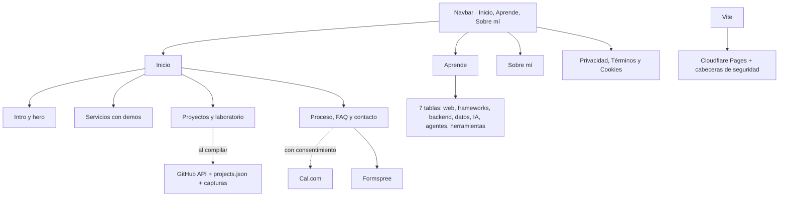

# Frank Abanto

**Software e IA hechos a tu medida.**

## Qué incluye

- 🖥️ **Servicios** — Páginas web, automatizaciones e IA, cada uno con una demo interactiva.
- 🗂️ **Proyectos** — Repositorios de GitHub sincronizados al compilar. Son práctica y piezas personales.
- 📚 **Aprende** — Siete tablas periódicas, de los fundamentos web a los agentes de IA, con vista previa en vivo.
- 📅 **Agenda y contacto** — Formulario (Formspree) y llamadas con Cal.com, solo si aceptas cookies de terceros.
- ⌨️ **Paleta de comandos** — Acceso rápido a secciones y páginas con `Ctrl` / `⌘ + K`.
- 🔒 **SEO y seguridad** — Metadatos, sitemap y cabeceras de seguridad en Cloudflare Pages.

## Cómo funciona

## Contacto

