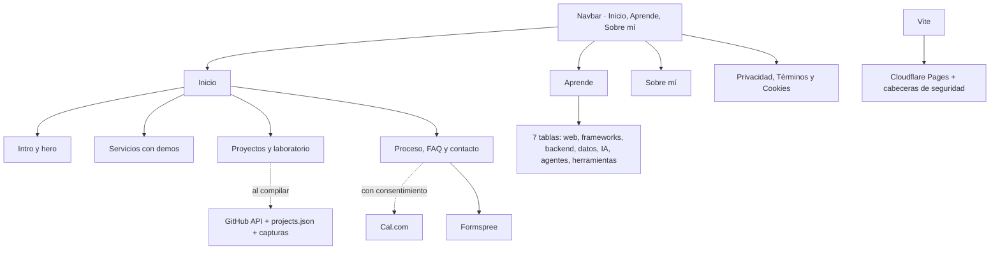

# Frank Abanto

**Software e IA hechos a tu medida.**

## Qué incluye

<table>
  <tr>
    <td width="33%" valign="top" align="center">
       
      🖥️
       
      <strong>Servicios</strong>
       
      Páginas web, automatizaciones e IA, cada uno con una demo interactiva.
        
    </td>
    <td width="33%" valign="top" align="center">
       
      🗂️
       
      <strong>Proyectos</strong>
       
      Repositorios de GitHub sincronizados al compilar. Son práctica y piezas personales.
        
    </td>
    <td width="33%" valign="top" align="center">
       
      📚
       
      <strong>Aprende</strong>
       
      Siete tablas periódicas, de los fundamentos web a los agentes de IA, con vista previa en vivo.
        
    </td>
  </tr>
  <tr>
    <td width="33%" valign="top" align="center">
       
      📅
       
      <strong>Agenda y contacto</strong>
       
      Formulario (Formspree) y llamadas con Cal.com, solo si aceptas cookies de terceros.
        
    </td>
    <td width="33%" valign="top" align="center">
       
      ⌨️
       
      <strong>Paleta de comandos</strong>
       
      Acceso rápido a secciones y páginas con <code>Ctrl</code> / <code>⌘ + K</code>.
        
    </td>
    <td width="33%" valign="top" align="center">
       
      🔒
       
      <strong>SEO y seguridad</strong>
       
      Metadatos, sitemap y cabeceras de seguridad en Cloudflare Pages.
        
    </td>
  </tr>
</table>

## Cómo funciona

---

## Contacto

&nbsp;

&nbsp;

&nbsp;

&nbsp;

&nbsp;

&nbsp;

